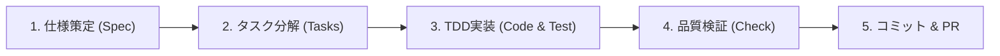

# AI駆動開発 (Spec-Driven Development) ワークフロー

AI（Antigravity, Cursor, Claude Code等）と協調して高品質なソフトウェアを開発するための標準プロセスです。

---

## 開発サイクルの4つのフェーズ

### フェーズ 1: 仕様策定 (Spec)
* **目的**: 作るもののスコープと要件を明確にし、AIの誤認や手戻りを防ぐ。
* **手順**:
  1. `docs/templates/SPEC_TEMPLATE.md` をコピーして仕様書（例: `docs/specs/user-auth.md`）を作成。
  2. ユーザー（人間）とAIで「何を作り、何を作らないか」「入出力」「エラー処理」を合意する。

### フェーズ 2: タスク分解 (Tasks)
* **目的**: 巨大な機能を、AIが1回で確実に消化できる小さなタスク（1タスク = 1テスト〜数ファイルの変更）に分解する。
* **手順**:
  1. `docs/templates/TASK_LIST_TEMPLATE.md` をコピーしてタスクリストを作成。
  2. 各タスクに「検証方法（テストコマンド）」を明記する。

### フェーズ 3: テスト駆動実装 (TDD)
* **目的**: コードが要件を満たしているかを常に検証しながら進める。
* **手順**:
  1. **Red**: まず失敗するテストコードを書く。
  2. **Green**: テストが通過する最小限の実装コードを書く。
  3. **Refactor**: テストが通った状態を維持しながらコードを綺麗にする。

### フェーズ 4: 品質自動検証 (Check)
* **目的**: 静的解析、型チェック、コードスタイル、全テストが合格しているか最終確認。
* **手順**:
  - `.\run.ps1 check` （Mac/Linuxは `./run.sh check` または `make check`）を実行。
  - エラーや警告が0件であることを確認。

### フェーズ 5: コミット & Pull Request
* **手順**:
  - Conventional Commits形式（`feat:`, `fix:`, `refactor:` 等）でコミット。
  - `.github/pull_request_template.md` に従ってPRを作成。
